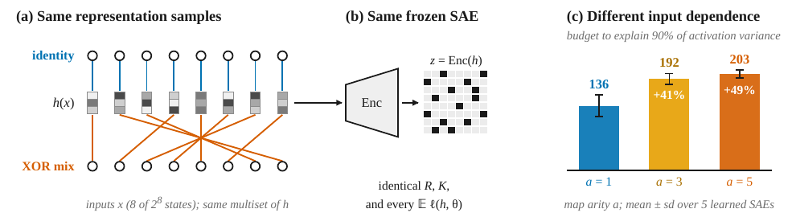
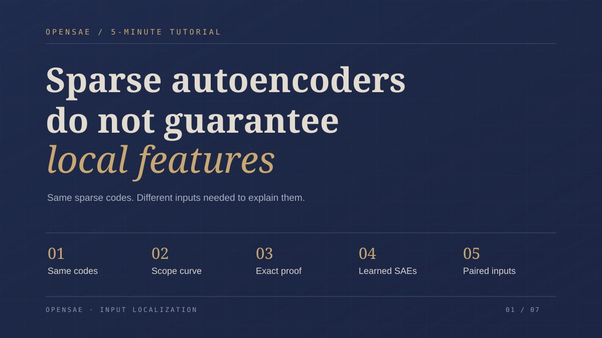
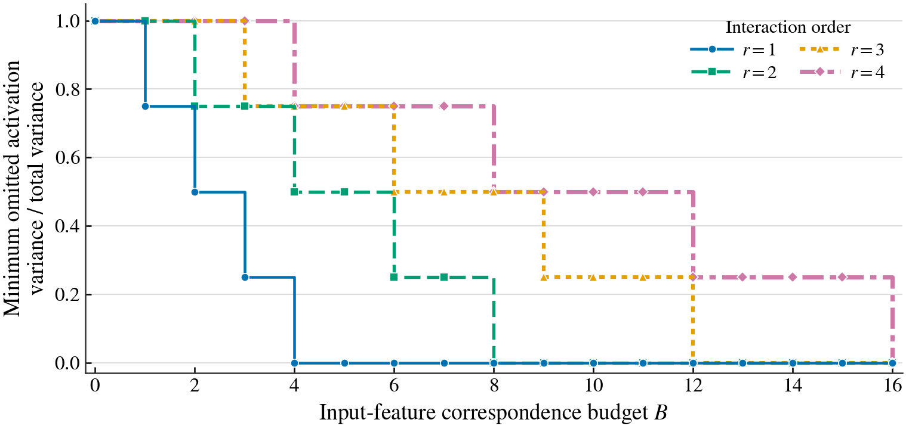
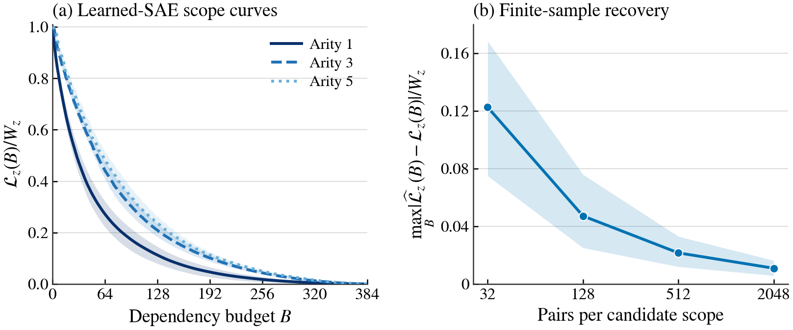
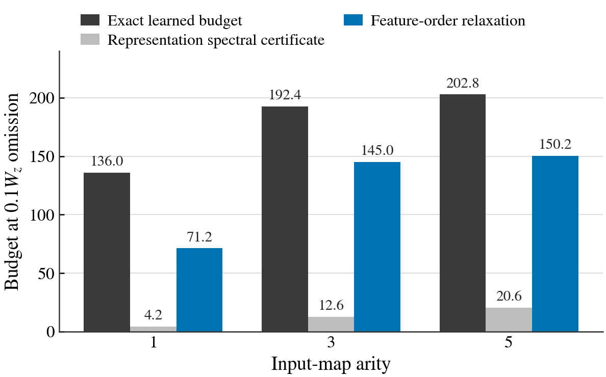
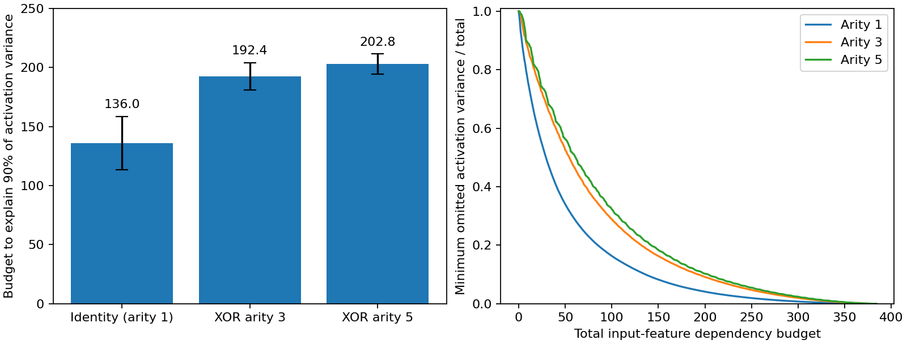

# 🧭 Sparse Autoencoders Do Not Guarantee Local Features

🌍 Languages: [English](README.md) | [中文](README_cn.md)

👉 TL;DR. Sparse autoencoders can reconstruct identical representations while their features depend on different inputs. We introduce **optimal input scope curves** to measure how compactly controlled inputs explain SAE feature activations.

<p align="center">
  <b>📄 arXiv paper coming soon</b> &nbsp; | &nbsp;
  <a href="https://htmlpreview.github.io/?https://github.com/OpenSAE/SAE-Input-Localization/blob/main/docs/index.html"><b>🎞️ 5-minute tutorial</b></a> &nbsp; | &nbsp;
  <a href="#-demo"><b>🧪 Demo</b></a>
</p>

## 🎥 Overview

<p align="center">
  
</p>

**Figure 1.** Two bijective input maps provide exactly the same representation samples to the same frozen SAE. Yet the inputs needed to explain its feature activations differ. Across five learned SAEs, the budget needed to explain 90% of activation variance increases by **41% and 49%** under the mixed maps.

---

## 🎞️ 5-Minute Tutorial

<p align="center">
  <a href="https://htmlpreview.github.io/?https://github.com/OpenSAE/SAE-Input-Localization/blob/main/docs/index.html"></a>
</p>

💻 Click to open the [tutorial](https://htmlpreview.github.io/?https://github.com/OpenSAE/SAE-Input-Localization/blob/main/docs/index.html) in your browser

---

## ✨ Highlights

- 🧩 **Identical representations, different dependencies.** The same SAE and representation distribution can require exactly **r times** the input scope budget under an order-r input map, even when sparse coding uniquely selects the shared dictionary.
- 📐 **Optimal scope curves.** The curve finds the smallest feature-activation variance left unexplained under a total input-dependency budget, distinguishing sparsity from localization.
- 📈 **Learned SAEs confirm the separation.** Across five trained overcomplete SAEs, the mean budget for 90% explained activation variance rises from **136.0** to **192.4** and **202.8** under three- and five-factor XOR maps.
- 🎲 **Paired interventions recover the curve.** The mean maximum normalized curve error drops from **0.123** to **0.0109** as pairs per candidate scope increase from 32 to 2,048.
- 🛡️ **Lower bounds on localization cost.** Compatibility and spectral results connect joint input effects, decoder directions, and the number of input-feature dependencies.
- ⚡ **A lightweight estimator.** The core implementation uses NumPy. The included five-SAE demo runs directly from released activations, with no model download or retraining.

---

## 📐 What Localize Measures

<details>
<summary>🧩 Input scopes and SAE features</summary>

For controlled inputs $`x=(x_1,\ldots,x_n)`$, let $`h(x)`$ be a model representation and $`z(x)=\mathrm{Enc}(h(x))`$ the activations of a frozen SAE. Assign each feature $`j`$ an input scope $`A_j\subseteq[n]`$, the variables used to explain that activation. The total scope budget is

$$B(A)=\sum_j|A_j|.$$

SAE sparsity counts active features; $`B(A)`$ instead counts input-feature dependencies.

</details>

<details>
<summary>📉 Optimal input scope curve</summary>

For a proposed scope $`A_j`$, the best predictor of feature $`z_j`$ from those inputs is its conditional mean. The total omitted activation variance is

$$\Gamma_z(A)=\sum_j\mathbb E\left[\left(z_j-\mathbb E[z_j\mid x_{A_j}]\right)^2\right].$$

The optimal scope curve and its inverse are

$$\mathcal L_z(B)=\min_{B(A)\le B}\Gamma_z(A),\qquad \mathcal B_z(\tau)=\min\{B:\mathcal L_z(B)\le\tau\}.$$

$`\mathcal L_z(B)`$ reports the unexplained activation variance at budget $`B`$; $`\mathcal B_z(\tau)`$ is the minimum budget needed to reach tolerance $`\tau`$.

</details>

<details>
<summary>🎲 Estimation from paired interventions</summary>

For independent $`x,x'`$ from a product intervention distribution and a feature scope $`A`$, form $`y=(x_A,x'_{-A})`$. Then

$$\mathbb E\left[\left(z_j(x)-\mathbb E[z_j\mid x_A]\right)^2\right]=\frac12\mathbb E\left[\left(z_j(x)-z_j(y)\right)^2\right].$$

Paired resampling estimates the omission error for a candidate scope. Combining those estimates with scope optimization recovers an empirical curve; the paper also provides simultaneous finite-sample control after scope selection.

</details>

<details>
<summary>🛡️ Compatibility and spectral bounds</summary>

Pure input interactions require features whose scopes contain the jointly contributing inputs. Those features must also provide decoder directions capable of representing the interaction. The paper derives lower bounds from these two constraints and from the spectrum of higher-order input effects.

</details>

---

## 🔎 Comparison of Methods

The controlled experiment fixes the representation samples and trained SAE, then changes their correspondence with the input variables.

| Measurement | What it describes | Identity vs. XOR maps |
|---|---|:---:|
| Reconstruction error | Accuracy of the reconstructed representation | Same |
| Activation sparsity | Number of active SAE features | Same |
| Representation and activation samples | Distribution of $`h`$ and $`z`$ | Same |
| **Optimal input scope curve** | Inputs required to explain SAE activations | **Different** |
| **Paired input interventions** | Activation variance omitted by a chosen scope | **Different** |

The results separate representation quality from input localization: the same sparse features can have different input-dependency structures.

---

## ⚙️ Install

```bash
git clone https://github.com/OpenSAE/SAE-Input-Localization.git
cd SAE-Input-Localization
pip install -e .
```

The core methods need only NumPy (Python 3.10+). For tests, use `pip install -e ".[dev]"`; for training experiments, use `pip install -e ".[experiments]"`.

---

## 🚀 Quickstart

```python
import numpy as np
from sae_localize import exact_scope_curve

# Two SAE features over three controlled binary inputs.
x = np.arange(8)
z = np.column_stack([x & 1, (x >> 1) & 1]).astype(float)

# A bijection mixes the first two inputs, preserving every SAE code sample.
mixed_ids = ((x & 1) ^ ((x >> 1) & 1)) | (x & ~1)
identity = exact_scope_curve(z, n_factors=3)
mixed = exact_scope_curve(z[mixed_ids], n_factors=3)

print(identity.budget(0), mixed.budget(0))
# 2 3
```

💡 The representation and activation samples are unchanged. Under the mixed input map, one feature needs both input factors instead of just one, increasing the exact dependency budget from 2 to 3.

🧰 **Your own SAE.** Supply a NumPy array of frozen feature activations with shape `(2**n_factors, n_features)`, ordered by the binary input configuration. Compute its curve with `exact_scope_curve(z, n_factors=n)` or run:

```bash
python demo/custom_activations.py my_codes.npy --n-factors 8
```

---

## 📊 Main Results

<details>
<summary>🧠 Figure 2. Exact separation for the same frozen SAE</summary>

<p align="center"></p>

For $`n=4`$ input factors over $`\mathbb F_7`$, the four input maps preserve the representation distribution and SAE while changing the interaction order. The budget required for exact localization increases by precisely the interaction order $`r`$.

</details>

<details>
<summary>📈 Figure 3. Learned SAE localization and finite-sample recovery</summary>

<p align="center"></p>

Five independently trained representation–SAE pairs are evaluated over all 256 configurations of eight controlled binary inputs.

| Input map | Mean budget at 90% explained variance | Change |
|---|---:|---:|
| Identity | 136.0 | — |
| XOR, arity 3 | **192.4** | **+41.5%** |
| XOR, arity 5 | **202.8** | **+49.1%** |

Finite paired sampling progressively recovers the exact curves:

| Pairs per candidate scope | 32 | 128 | 512 | 2,048 |
|---|---:|---:|---:|---:|
| Mean maximum normalized curve error | 0.123 | 0.0472 | 0.0216 | **0.0109** |

</details>

<details>
<summary>🛡️ Appendix Figure 4. Spectral and feature-order bounds</summary>

<p align="center"></p>

| Input map | Exact budget | Spectral bound | Feature-order bound |
|---|---:|---:|---:|
| Identity | 136.0 | 4.2 | 71.2 |
| XOR, arity 3 | 192.4 | 12.6 | 145.0 |
| XOR, arity 5 | 202.8 | 20.6 | 150.2 |

The feature-order bound is tighter because it retains SAE feature-level interaction information discarded by the representation-level spectral bound.

</details>

---

## 🧪 Demo

Run the five-seed learned-SAE comparison using the included reference activations:

```bash
python demo/demo.py
```

```text
Map          Five seed budgets            Mean ± sample SD
Identity     [128, 147, 168, 129, 108]   136.0 ± 22.6
XOR arity 3  [206, 197, 197, 186, 176]   192.4 ± 11.6
XOR arity 5  [215, 204, 205, 192, 198]   202.8 ±  8.6
```

<p align="center"></p>

✅ The demo recomputes the optimized scope curves and reproduces the headline results. To retrain all five SAEs or regenerate the figures, see the [reproduction guide](docs/REPRODUCIBILITY.md).

---

## 🗺️ Figure Map

| Figure | Main finding | Reproduction |
|---|---|---|
| [Figure 1](assets/figures/fig1.png) | Same representations and SAE, different input dependence | Overview |
| [Figure 2](assets/figures/fig2.png) | Exact separation across interaction orders | [`verify_family.py`](experiments/exact_construction/verify_family.py) |
| [Figure 3](assets/figures/fig3.png) | Learned SAE scope curves and paired recovery | [`pilot.py`](experiments/learned_sae_validation/pilot.py), [`audit.py`](experiments/learned_sae_validation/audit.py) |
| [Appendix Figure 4](assets/figures/fig4.png) | Spectral and feature-order bounds | [`code_order_bound.py`](experiments/learned_sae_validation/code_order_bound.py) |

---

## 🙏 Appreciation

Part of [OpenSAE](https://github.com/OpenSAE), alongside [Behavioral Compositionality (SAR)](https://github.com/OpenSAE/SAE-Behavioral-Compositionality), [Representation Redistribution (RSS)](https://github.com/OpenSAE/Redistribution-Sensitivity-Score), and the [SAEBase](https://github.com/OpenSAE/SAEBase) research infrastructure.


